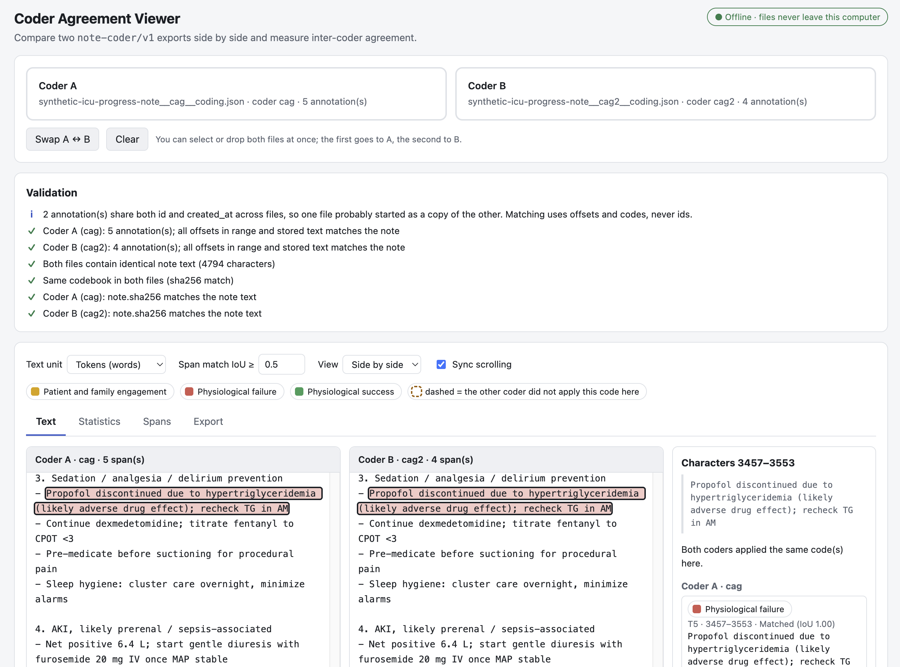
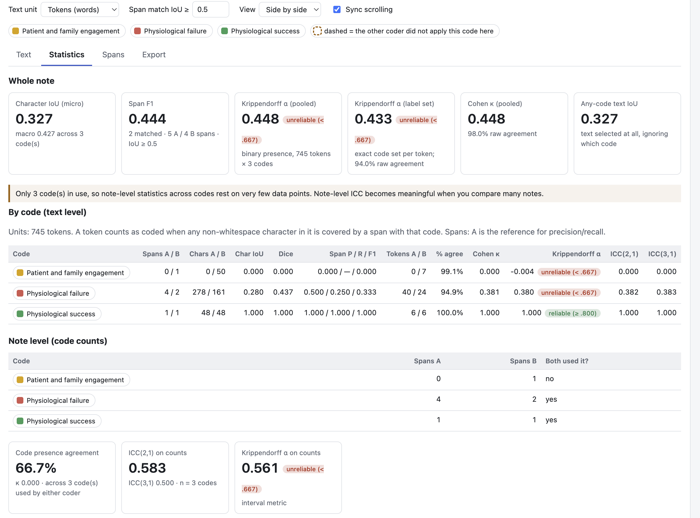

# Coder Agreement Viewer

A single, offline HTML file for comparing two coders' annotations of the same clinical note, side by side, with inter-coder agreement statistics at the text level and for the whole note.

It reads the `note-coder/v1` JSON export format (see [`examples/`](examples/)). Everything runs in your browser: there is nothing to install, no server, and no network access.





*Screenshots show the synthetic example note and example coding in [`examples/`](examples/); no real patient data.*

## Quick start

1. Download [`coder-agreement-viewer.html`](coder-agreement-viewer.html) (on GitHub: open the file, then **Download raw file**).
2. Double-click it to open it in Chrome, Edge, Firefox or Safari.
3. Drop two coder exports for the same note onto the page (or select both at once). The first goes to Coder A, the second to Coder B.

To try it, use the two synthetic files in [`examples/`](examples/).

## What it shows

**Validation.** Before comparing anything, it checks that:

- both files contain identical note text (otherwise offsets are not comparable, and comparison is blocked);
- the codebook hashes match;
- offsets are in range, UTF-16, zero-based and end-exclusive;
- each annotation's stored `text` matches the note at its offsets;
- each `note.sha256` matches the note text.

It also flags annotations whose `id` and `created_at` are shared across files, which usually means one file started as a copy of the other. Spans are always matched by position and code, never by id.

**Text tab.** The note is shown side by side with synced scrolling, or as a merged view colored by *A only*, *B only*, *same codes* and *different codes*. Click any highlight to see both coders' spans and comments at that spot.

**Statistics tab.**

| Level | Measures |
|---|---|
| Per code | Character IoU, Dice, span precision / recall / F1, Cohen's κ, Krippendorff's α (nominal), ICC(2,1) and ICC(3,1) |
| Whole note | Micro and macro IoU, code-agnostic IoU, overall span F1, pooled κ and α, label-set α |
| Note level | ICC and Krippendorff's α (interval) on span counts per code |
| Code present (yes / no) | Whether each coder used each code anywhere in the note: 2×2 counts, % agreement, positive and negative agreement, Cohen's κ, Krippendorff's α. Computed over codes either coder used, and over the whole codebook (codes neither used count as agreeing "no") |

Text-level statistics use a unit you choose: **tokens** (default), **sentences/lines**, or **characters**. Span matching uses an adjustable IoU threshold (default 0.5). Krippendorff's conventional reliability bands are shown next to each α. The **How these are calculated** section on the page gives exact definitions.

**Spans tab.** Every span from both coders, labeled *matched*, *partial overlap*, *different code*, *same code elsewhere* or *no counterpart*. Click a row to jump to it in the text.

**Export tab.** Exports are:

- a full JSON report with all statistics, settings, validation results and file hashes, for reproducibility;
- per-code and span CSVs;
- a print/PDF view of the statistics.

## Interpreting the numbers

- **Most text is uncoded**, so κ and α can be modest even when raw agreement is 98%. Read them alongside % agreement and IoU.
- **Note-level ICC and α across codes** rest on very few data points for a single note (one per code). They become meaningful when you aggregate across many notes.
- **Codes neither coder used** are not named in the exports. The yes/no section shows both versions: one over codes used by either coder, and one over the whole codebook (using `codebook.code_count`, only when both files share the same codebook hash), where unused codes count as agreeing "no".
- **Same idea, different place:** if two coders code the same event in different sections (say, Subjective vs. Assessment & Plan), span metrics count it as a disagreement. The Spans tab labels these *same code elsewhere* so you can adjudicate them.

## Security and privacy

The tool is designed for notes that may contain PHI.

- **No network.** A strict Content-Security-Policy (`default-src 'none'; connect-src 'none'`, and so on) blocks every outbound connection. Only the page's own inline script and style run, pinned by SHA-256 hash. There are no CDNs, fonts, analytics or update checks.
- **Nothing persists.** No `localStorage`, cookies or IndexedDB. Closing the tab discards everything.
- **Untrusted input stays inert.** Note text, codes, ids and comments are always inserted as plain text (`textContent`), never parsed as HTML. The browser test includes a script- and image-injection probe.
- **Input validation.** JSON only, 25 MB file cap, offsets bounds-checked, malformed annotations reported and skipped.
- **Exports stay local.** They are generated in the browser and saved to your downloads folder. CSV cells are guarded against spreadsheet formula injection. The span CSV contains note excerpts, so handle it like the source notes.
- **Auditable.** It is one readable file with no dependencies or build-time bundling.

## Development

The app is edited in [`src/viewer.template.html`](src/viewer.template.html). [`scripts/build.py`](scripts/build.py) computes the CSP hashes and writes `coder-agreement-viewer.html`, which is committed so users can download it directly.

```sh
python3 scripts/build.py            # rebuild after editing the template
python3 scripts/build.py --check    # verify the committed build is current

node --test tests/core.test.mjs     # unit tests for the statistics core (Node 18+)
python3 tests/reference_check.py    # cross-check κ / α / ICC against independent numpy implementations
python3 tests/ui_test.py            # headless Chromium: rendering, no network, no console errors, injection probe
```

`tests/ui_test.py` needs `pip install playwright && playwright install chromium`. `tests/reference_check.py` needs `numpy` and, optionally, `scikit-learn`.

Continuous integration runs the build check, the unit tests and the reference check on every push.

### Input format

Each file is one coder's export for one note.

```jsonc
{
  "schema": "note-coder/v1",
  "coder_id": "cag",
  "note_id": "synthetic-icu-progress-note",
  "offsets": { "base": 0, "end": "exclusive", "unit": "utf16_code_units" },
  "codebook": { "name": "...", "sha256": "...", "code_count": 6 },
  "note": { "char_count": 4794, "sha256": "...", "text": "..." },
  "annotations": [
    { "id": "T1", "code": "physiological_failure", "label": "Physiological failure",
      "start": 264, "end": 307, "text": "Remains intubated on mechanical ventilation", "comment": "" }
  ]
}
```

## Roadmap

- Batch mode over a folder of note pairs, where note-level ICC and α become meaningful
- Load the codebook file, to count codes neither coder used and show code definitions
- Krippendorff's unitizing alpha (uα)
- More than two coders
- Adjudication: produce a consensus file in the same format

## License

Copyright (C) 2026 cag-lab contributors.

This program is free software: you can redistribute it and/or modify it under the terms of the GNU General Public License as published by the Free Software Foundation, either version 3 of the License, or (at your option) any later version. See [LICENSE](LICENSE).

The files in `examples/` are synthetic and contain no real patient data.
